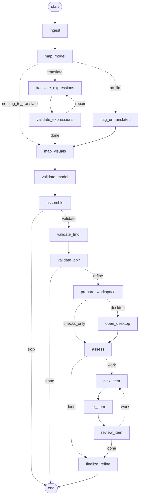

# t2pbi — Tableau → Power BI migrator

[](https://github.com/AGiorni/tableau-to-powerbi-migrator/actions/workflows/ci.yml)

AI-assisted tool that ingests a machine-readable Tableau workbook (`.twb` / `.twbx`) and
produces a Power BI Project (`.pbip`) folder ready to open in Power BI Desktop.

## Architecture

A **LangGraph state graph** built around two **Intermediate Representations (IRs)**: the workbook
is parsed into a Tableau IR, mapped to a Power BI IR, and only then written out as TMDL + PBIR.
The graph is the only way a migration runs, from the CLI and from tests alike.



Dotted edges are decisions made by a router at run time. Regenerate the exact diagram from the
code with `python -c "from t2pbi.graph import build_graph; print(build_graph().get_graph().draw_mermaid())"`.

Deterministic code does parsing and generation. LLMs (Azure OpenAI) are used only where the
workbook is genuinely ambiguous: calculated field → DAX translation (with a validate-and-repair
loop) and visual mapping for worksheets no rule matches. With no LLM configured, the graph
takes the deterministic route and still produces an openable project.

## Status

Working end to end on the sample workbooks:

- **Data model** — tables, relationships, typed Power Query for CSV, Excel, SQL Server,
  PostgreSQL and MySQL; calculated fields translated to DAX (LLM) or flagged for review.
- **Worksheets → visuals** — shelf-aware mapping (orientation, time axis, series, small
  multiples), Measure Names/Values sheets as tables, maps, and an LLM router for ambiguous
  sheets, all checked against Power BI's visual catalog.
- **Dashboards → report pages** with slicers. A worksheet gets a page of its own only if Tableau
  viewers can open it as a tab: a sheet hidden in Tableau and shown on a dashboard is only a
  visual on that dashboard's page.
- **Validation** — after the build, Microsoft's own checkers read the written files: TOM's TMDL
  serializer for the model and `powerbi-report-author validate` for the report; diagnostics land
  in the migration report.
- **Fidelity** — `scripts/fidelity.py` scores how faithfully the samples are migrated, against
  hand-reviewed expectations in `samples/<workbook>/expected.toml`: structure (in CI), and with
  `--render` the numbers (queried in Power BI Desktop) and the pictures (an LLM compares Desktop
  screenshots with Tableau screenshots in `samples/<workbook>/screenshots/`). The samples and
  their layout are described in [samples/README.md](samples/README.md).

Open work is in [BACKLOG.md](BACKLOG.md); the reasoning behind past decisions is in
[docs/DEVLOG.md](docs/DEVLOG.md). For a visual map of the pipeline, open
[docs/architecture.html](docs/architecture.html) in a browser.

## Quick start

```powershell
python -m venv .venv
.\.venv\Scripts\Activate.ps1
pip install -e ".[dev]"
copy .env.example .env    # then fill in your settings (Azure OpenAI, Power BI Desktop path)
pytest
```

Settings and secrets live in `.env` (gitignored); `.env.example` lists them all. Real
environment variables take precedence over the file.

Optional, for validating the written project (each check is skipped if its tool is missing):
Microsoft's pinned Power BI tools (needs Node.js) and the TMDL validator (needs a .NET 8 or later SDK).

```powershell
cd tools; npm ci; cd ..
dotnet publish tools\tmdl-validate -c Release -o tools\tmdl-validate\bin\publish
```

Run a migration (deterministic path, no LLM calls):

```powershell
t2pbi migrate .\samples\Book1\Book1.twb --out .\out --no-llm --report .\out\report.json
```

With `--refine` (needs Azure OpenAI, with a deployment that takes tool calls and images), a
refinement agent then fixes what the first pass got wrong, one page at a time:

```powershell
t2pbi migrate .\samples\Book1\Book1.twb --out .\out --refine --reference-images .\samples\Book1\screenshots
```

- The output folder becomes a git repository: the first pass is the baseline commit, and every
  change the agent makes that is kept is one more commit (`git log`, `git diff` to review it).
- The work list comes from checks derived from the workbook, problems in the report and — with
  Power BI Desktop — a visual judge comparing each page with your screenshots of the Tableau sheet
  (`--reference-images`: one folder per sheet, named after it, with one or more images). Pages
  without screenshots aren't compared with a picture; without the option, Desktop isn't opened.
  The small thumbnails Tableau stores in the workbook are not used: too little detail to judge by.
- The agent edits the report's PBIR JSON files directly, the way Microsoft's report-authoring
  tooling expects: it reads a page or visual file, looks up visual roles, formatting properties and
  literal encodings with `powerbi-report-author`, and saves the file. Every save is validated —
  Microsoft's PBIR validator plus t2pbi's check that every field exists in the model — and the
  errors go back to the agent to repair. A deterministic review then keeps a change only if the
  validators stay clean, no check that passed breaks, and the page improves; otherwise it's
  reverted and the page gets one retry with the reasons.
- Desktop needs the Desktop Bridge (`npm ci` in `tools/`) and the Authoring MCP's EULA accepted
  by you (`PBI_MODELING_MCP_ACCEPT_EULA=true`) to load the data; without them, or with
  `--no-desktop`, the review uses the checks alone.
